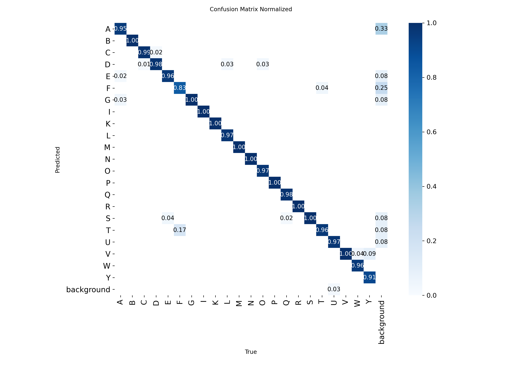

🇧🇷 Português · 🇺🇸 [English summary](#english-summary)

# Reconhecimento do Alfabeto em LIBRAS na Borda — Raspberry Pi Zero 2 W

Projeto final da Parte 1 da disciplina IESTI05 – Machine Learning System Engineering (UNIFEI), sob orientação do Prof. Marcelo Rovai ([@Mjrovai](https://github.com/Mjrovai)). Pipeline de detecção de objetos do dataset ao deploy em tempo real, que reconhece as 22 letras estáticas do alfabeto manual de LIBRAS,inferência 100% local, em um Raspberry Pi Zero 2 W.

## Estrutura

```
LibrasAlphabetRecognition/
├── src/
│   ├── real-time-libras.py            # aplicação: captura + inferência + servidor Flask
│   ├── analisar_log.py                # FPS e latência a partir do infer_log.csv
│   ├── yolo-treinamento-libras.ipynb  # treinamento (Kaggle)
│   └── yolo-inferencia.ipynb          # inferência com imagens
├── models/
│   ├── best_int8.tflite               # YOLOv8n INT8 (320 x 320), usado na Pi
│   ├── best.pt                        # modelo treinado em FP32 (640 x 640)
│   └── args.yaml                      # hiperparâmetros do treinamento
├── dataset/                           # data.yaml (classes e caminhos); 
├── docs/                              # resultados do treino (métricas, matrizes de confusão, curvas) e exemplos
├── requirements.txt                   # dependências instaladas via pip
├── LICENSE
└── README.md
```

## Detecção de Objetos (YOLOv8n INT8)

Modelo YOLOv8n treinado por transfer learning (pesos COCO) no dataset `libras-unificado`, exportado para TensorFlow Lite com quantização INT8 e executado na Pi com LiteRT (`ai-edge-litert`). A aplicação roda captura, inferência e streaming em threads separadas e exibe vídeo, caixas, letra reconhecida e uso de RAM em uma interface web Flask.

**Resultados**

| Modelo | mAP@0,5 | mAP@50–95 |
|---|---|---|
| FP32, 640 px | 0,969 | 0,727 |
| FP32, 320 px | 0,959 | 0,694 |
| **INT8, 320 px (implantado)** | 0,940 | 0,611 |

No teste ao vivo na Pi Zero 2 W: **56/66 acertos (84,8 %)**, **1,73 FPS** e latência de inferência de ≈ 364 ms. Os erros se concentraram em T e em letras de configuração parecida (F, N, Q). A confiança do modelo INT8 é quase constante (≈ 50 %), então não deve ser lida como probabilidade.
 


*Matriz de confusão normalizada (validação, FP32 640 px). A matriz com contagens e as demais curvas estão em [`docs/results/`](docs/results/) .*

**Dataset:** fusão de dois conjuntos públicos do Roboflow Universe (CC BY 4.0), com correção manual de caixas e unificação de classes: 4.467 imagens, divisão 70/20/10 e augmentation 3x no treino. 🔗 [libras-unificado no Roboflow](https://app.roboflow.com/mel-cabral-fiore-brito/libras-unificado/overview)

## Dependências
 
Ambiente: Raspberry Pi Zero 2 W + Camera Module v1.3 · Raspberry Pi OS 64-bit · treinamento no Kaggle (GPU T4).
 
Bibliotecas: `ai-edge-litert`, `flask` e `psutil` (via `pip`, versões testadas no `requirements.txt`); `picamera2`, `opencv` e `numpy` (via `apt`). Os comandos de instalação estão em [Como executar](#como-executar-na-raspberry-pi).
 
> Nota: `picamera2`, `opencv` e `numpy` são instalados pelo `apt` (`python3-picamera2 python3-opencv python3-numpy`), e o ambiente virtual deve ser criado com `--system-site-packages`. O `picamera2` é compatível apenas com o Raspberry Pi OS (Bullseye ou posterior).

## Como executar (na Raspberry Pi)

```bash
git clone https://github.com/melfioree/LibrasAlphabetRecognition.git
cd LibrasAlphabetRecognition

sudo apt update
sudo apt install -y python3-picamera2 python3-opencv python3-numpy tmux
python3 -m venv --system-site-packages ~/libras-env
source ~/libras-env/bin/activate
pip install -r requirements.txt

tmux new -s libras
taskset -c 0,1 python3 src/real-time-libras.py
```

Depois, abra `http://[IP da Pi]:5000` em um computador ou celular na mesma rede Wi-Fi e clique em **Iniciar Detecção**.


## Créditos
 
Datasets do Roboflow Universe, sob licença [CC BY 4.0](https://creativecommons.org/licenses/by/4.0/), alterados pelas autoras (união dos conjuntos, correção de caixas, unificação de classes e nova divisão em treino, validação e teste). O `libras-unificado` é uma obra derivada e mantém a licença CC BY 4.0.
 
- **Georgia Silva**, [Libras proprio Object Detection Model](https://universe.roboflow.com/georgia-silva/libras-proprio) (v2), 2024.
- **Personal**, [Libras Object Detection Model (libras-ih14i)](https://universe.roboflow.com/personal-bu69s/libras-ih14i/dataset/5) (v5), 2024.
Modelo base: Ultralytics YOLOv8 (AGPL-3.0).<br>
Código deste repositório: licença MIT.

## Autoras

Debora Maria Rosa Siqueira (@debora-siqueira) — Engenharia de Computação, UNIFEI <br>
Mel Cabral Fiore Brito (@melfioree) — Engenharia de Computação, UNIFEI

---

## English summary

Edge AI project for IESTI05 – Machine Learning System Engineering (UNIFEI), under Prof. Marcelo Rovai ([@Mjrovai](https://github.com/Mjrovai)). Real-time recognition of the 22 static letters of the Brazilian Sign Language (LIBRAS) manual alphabet, running fully offline on a Raspberry Pi Zero 2 W:

* YOLOv8n fine-tuned on a merged Roboflow dataset (4,467 images, 22 classes), exported to TFLite INT8 (320 × 320) and run with LiteRT.
* mAP@0.5 of 0.940 (INT8) vs. 0.969 (FP32 640 px); live test on the Pi: 84.8% correct (56/66) at 1.73 FPS.
* Flask web interface with MJPEG streaming, adjustable confidence threshold and RAM monitoring.

Dataset: https://app.roboflow.com/mel-cabral-fiore-brito/libras-unificado/overview
